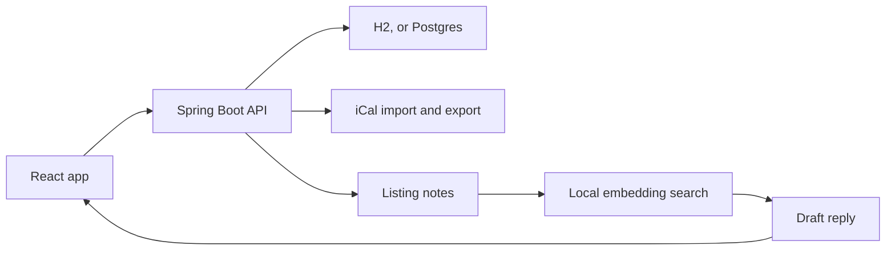

# CloudNine

CloudNine is a small vacation-rental notebook I built to practice the parts of a property system that are easy to get wrong: who is allowed in, whether two guests were given the same nights, and whether a reply to a guest actually came from that listing's notes.

I work on cloud and devops systems, and I wanted a project I could run on my own machine that still had real auth, a calendar feed, and a retrieval step in front of any language model. The interesting part was keeping one listing consistent across a direct booking, an imported calendar, and a drafted guest reply.

## What it does

- Sign in as a manager or an admin. Passwords are hashed. API calls carry a short-lived token.
- Keep listings: address, house rules, amenities, check-in and check-out notes, wifi, and the questions guests usually ask.
- Book stays on a month calendar. Check-in counts. Check-out does not, so a guest can arrive the morning another guest leaves.
- Import Airbnb-style and Vrbo-style `.ics` feeds, on a timer or from a button, and export a listing's calendar back out.
- Draft a reply from that listing's notes. You edit it and approve it before it counts as sent.
- Show upcoming arrivals, departures, and how many of the next 30 nights are already taken.

The people, cabins, and passwords in the seed data are made up.

## How the pieces fit



The browser talks only to the API. H2 is the default database so the app starts with nothing else installed. Postgres is a Spring profile, and that is what Docker Compose uses. Calendar files are parsed into stays. Guest replies are drafted from snippets of the listing you are looking at, not from a general chat.

## Features

**Accounts.** Register creates a manager. An admin account is seeded for the demo. Roles travel in the token.

**Listings and stays.** Each manager sees their own listings. Admins can see every listing. A stay is confirmed, blocked, cancelled, or flagged as a conflict.

**Calendars.** Each listing can have one feed per channel. Import matches an event by channel and UID. If a feed changes the UID but the dates are the same, the existing stay is updated instead of copied. A date that clashes with a stay you already have is flagged, and the stay you already have is left alone. A later import does not delete a stay just because it disappeared from the feed. The sample feed is built into the app.

**Guest replies.** On startup the listing notes are embedded with a small on-device model and kept in memory. With no API key, the draft is a fixed template filled with the snippets that matched the question. Set `OPENAI_API_KEY` (and optionally `OPENAI_BASE_URL` and `OPENAI_MODEL`) and the same snippets are handed to any OpenAI-compatible chat API. Nothing is marked sent until you approve it.

**Today.** Arrivals and departures for the next two weeks, and occupancy across the next 30 nights, both counted from the stays in the database.

## How double bookings are prevented

Saving a stay locks that listing's row for the rest of the database transaction, then looks for an existing confirmed stay or block whose nights overlap. Overlap means the existing check-in is before the new check-out, and the existing check-out is after the new check-in. The lock matters because adding a stay does not change a version number on the listing, so two requests can both pass a plain read and both insert.

On Postgres there is a second guard: a Flyway migration installs an exclusion constraint so two confirmed or blocked stays on the same listing cannot share a night, even if something bypasses the service. H2, which is the default for local runs and tests, does not support that constraint. The row lock and the overlap check still run there.

## Run it

You need Java 21 and Maven for the API, and Node 20 or newer for the UI. Docker is only required for the Postgres path.

**On this machine, with H2 (no database to install):**

```bash
./dev.sh
```

That starts the API on port 8088 and the UI on port 4173. Open [http://127.0.0.1:4173](http://127.0.0.1:4173).

Or start them yourself:

```bash
cd backend && mvn spring-boot:run
cd frontend && npm install && npm run dev
```

**With Postgres, API, and UI in Docker:**

```bash
docker compose up --build
```

The UI is on port 4173, the API on 8088, and Postgres on host port 5433. Compose sets the `postgres` profile, runs the Flyway migration (including the overlap constraint), and seeds the same demo listings.

API docs are at [http://127.0.0.1:8088/swagger-ui.html](http://127.0.0.1:8088/swagger-ui.html).

### Demo login

| Who | Email | Password | Role |
| --- | --- | --- | --- |
| Mara Ellison | mara@cloudnine.test | cloudnine-demo | Manager |
| Avery Quinn | admin@cloudnine.test | cloudnine-demo | Admin |

Mara's listings are Cedar & Pine Cabin in Bend and Saltglass Studio in Rockport. Cedar already has an Airbnb channel, so the "Import sample calendar" button on that listing loads a November 2026 feed. One of those events overlaps a seeded stay on purpose, so you can see a conflict flagged instead of overwriting the guest who was already there.

The wifi password on Cedar & Pine is `pinecone-1842`. Asking "What is the wifi password?" on that listing should put that code in the draft, because the draft is filled from the listing notes.

The token secret defaults to a local-only value. Set `JWT_SECRET` to a string of at least 32 characters before you point this at anything shared.

## Tests

```bash
cd backend && mvn test
cd frontend && npm test
```

Backend tests cover sign-in and roles, overlap (including a same-day turnover that is allowed), ten threads booking the same nights with one success and nine conflicts, iCal import that does not duplicate and does not overwrite a clash, and an offline draft that quotes the wifi password and stays a draft until it is approved.

If Docker is running, the same ten-thread booking test also runs against Postgres in Testcontainers, which applies the Flyway exclusion constraint. If Docker is not available, that one test is skipped and the H2 run still executes.

## Libraries

Spring Boot 3.5.16 and Java 21. Calendar parsing is ical4j 4.4.0, with relaxed parsing turned on so Airbnb and Vrbo all-day events (`VALUE=DATE`, exclusive end date) import as dates. Tokens are issued and checked with Spring's OAuth2 resource server and Nimbus (`HS256`). Retrieval uses LangChain4j 1.23.0, wired by hand. The MiniLM embedding package has no stable 1.23.0 release, so the app uses `1.23.0-beta33`, which is the build that matches that line. It is large, and it is what makes the offline draft a real search rather than a keyword scan.
